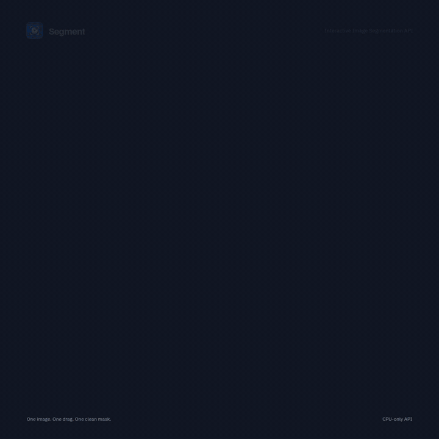
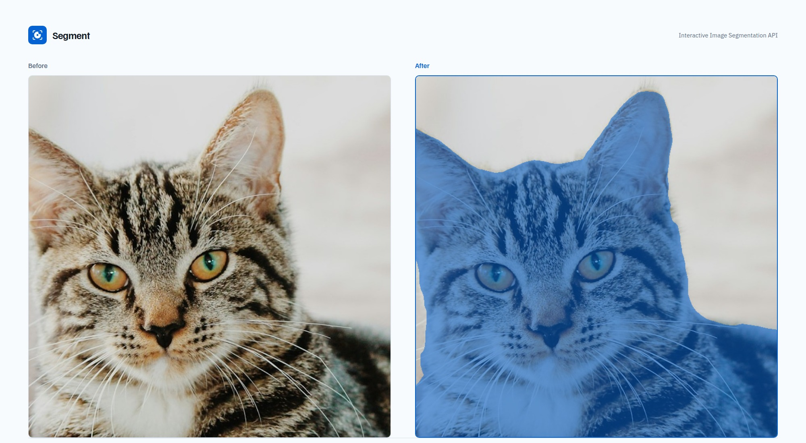
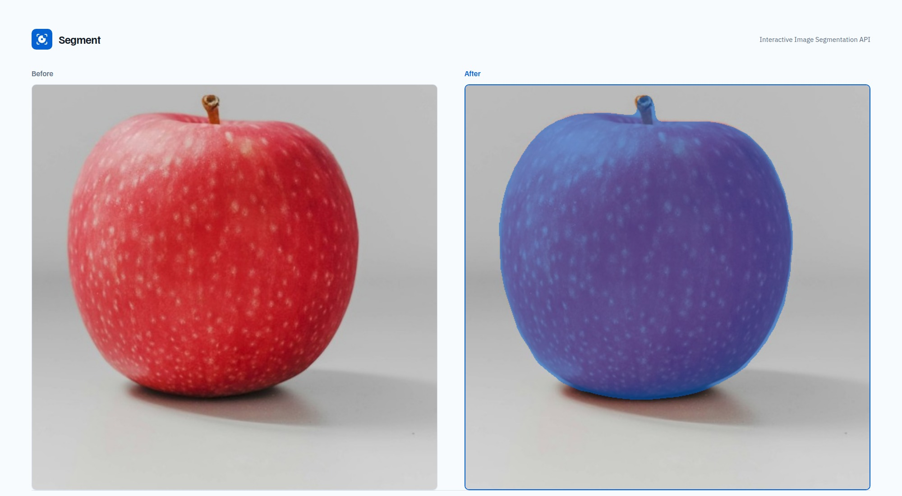
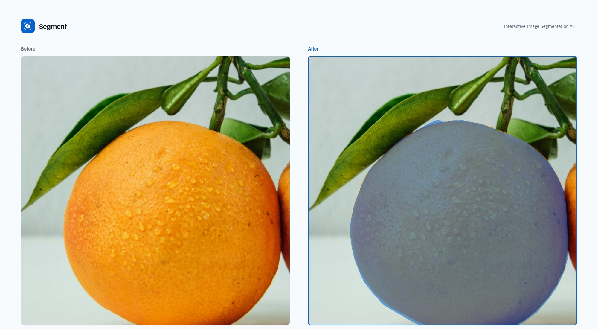

# Interactive Image Segmentation API: media kit

Promo video and before/after examples for the Interactive Image Segmentation API.

## Promo video

[Watch the 8-second MP4](https://github.com/tamnguyenvan/interactive-image-segmentation-media/blob/main/promo/interactive-image-segmentation-promo.mp4)

The demo shows an image being selected with a dragged line of positive points, followed by the returned mask.

## Examples

Left: original image. Right: selected object mask.

### Cat

### Apple

### Orange

## Use

These assets are provided for the Interactive Image Segmentation API listing and documentation.

- Promo MP4: `promo/interactive-image-segmentation-promo.mp4`
- Promo GIF: `promo/interactive-image-segmentation-promo.gif`
- Poster: `promo/poster.jpg`
- Showcase composites: `showcase/*-before-after.jpg`
- Icon: `logo.svg`, `logo-500.png`

Photos are from Unsplash under the Unsplash License. See [CREDITS.md](CREDITS.md).
